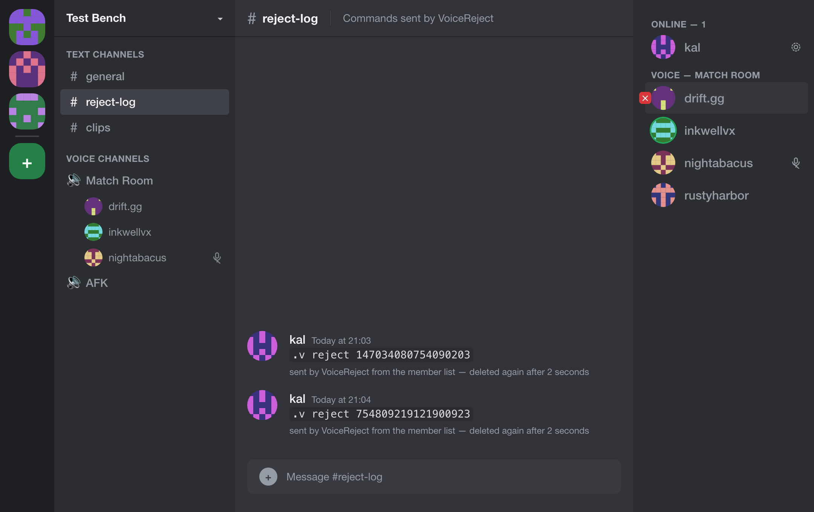
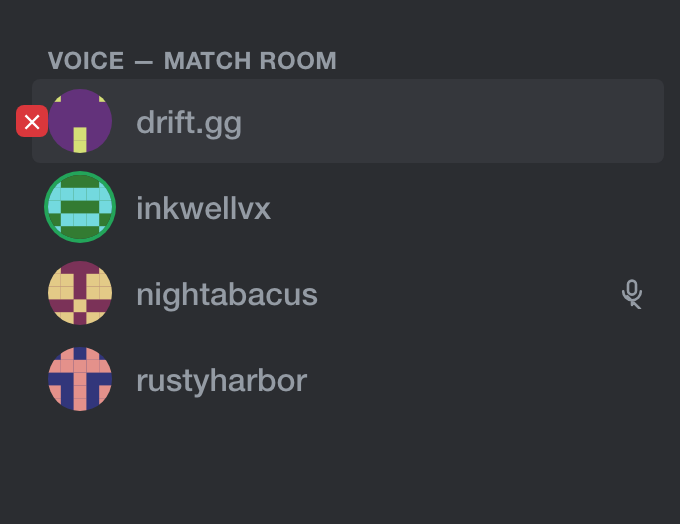
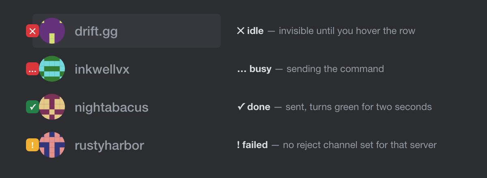
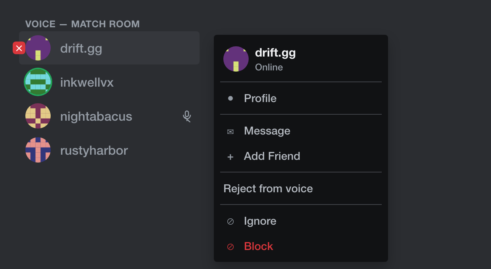
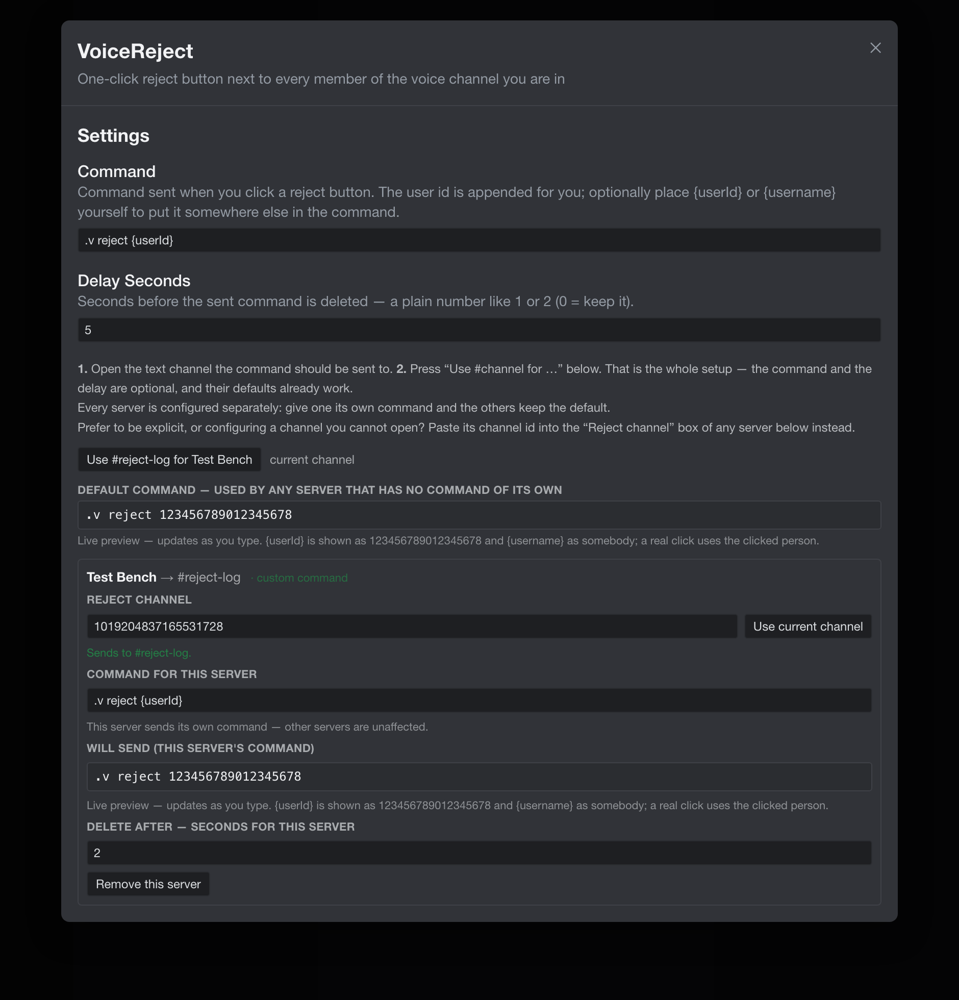

<div align="center">

# VoiceReject

**A one-click reject button for every other member of the voice channel you are in.**

A [Vencord](https://vencord.dev) userplugin. No bot account, no token, no second
process — the command is sent by your own client.

[](LICENSE)
[](https://vencord.dev)



<sub>Hover a member of your voice channel, click, and the command lands in the
channel you chose. **These screenshots are recreations** — the accounts, ids and
avatars in them are generated, so no real person or server appears. They are
drawn from the plugin's own markup and can be regenerated with
[`tools/screenshots.sh`](tools/screenshots.sh).</sub>

</div>

---

## What it does

Discord gives you no way to act on a voice channel member beyond muting or moving
them. Many moderation and matchmaking setups instead listen for a **chat command**
such as `.v reject <userId>`.

VoiceReject closes that gap. It adds a small button next to every other member of
the voice channel you are connected to. Clicking it:

1. builds a command from a template you choose (`.v reject {userId}` by default),
2. sends it to a text channel you pick **per server**,
3. deletes that message again after a configurable delay, so your channel is not
   left littered with command spam.

The whole thing runs inside your own Discord client through Vencord — there is no
separate process to babysit and no token to leak.

## Features

- **One click per member.** The button appears on the rows of other people in your
  channel, never on your own.
- **Per-server configuration.** Each server picks its own channel, its own command
  and its own delay. The global settings are only fallbacks.
- **Optional placeholder.** Write `.v reject {userId}` to place the id yourself, or
  just `.v reject` — the id is appended for you. `{id}` and `{username}` work too.
- **Live preview.** The settings show exactly what will be sent, rendered by the
  same code that sends it, so the preview cannot drift from reality.
- **Manual or automatic channel.** Open the channel and press *Use current channel*,
  or paste a channel id in — with validation that tells you what is wrong before
  you rely on it.
- **Unobtrusive.** The button is invisible until you hover the row, and it takes no
  layout space, so the member list does not shift.
- **Right-click too.** *Reject from voice* is also in the member context menu.

The button sits in the empty gutter left of the avatar, so the member list does
not shift when it appears, and it stays invisible until you hover the row:



It also reports what happened — `✕` on hover, `…` while sending, a green `✓`
once sent, an amber `!` when it could not send:



And from the member list's right-click menu:



## Requirements

- Discord **desktop** (macOS, Windows or Linux).
- A **Vencord source install**. Userplugins are built into the bundle, so they are
  not available in the prebuilt release — you need to build Vencord yourself.

## Installation

```bash
# 1. Build Vencord from source (skip if you already have a source install)
git clone https://github.com/Vendicated/Vencord ~/Vencord
cd ~/Vencord
pnpm install

# 2. Get this plugin and copy it in
git clone https://github.com/elioflex/vencord-voice-reject
cp vencord-voice-reject/plugins/VoiceReject.tsx src/userplugins/

# 3. Build, then patch Discord itself
pnpm build
pnpm inject      # only needed the first time
```

Then **fully restart Discord**. A rebuilt bundle is only picked up by a real
restart — Discord's login → app transition is client-side, so it will happily keep
running the old build otherwise.

The plugin ships with `enabledByDefault: true`, so it is on as soon as it loads.

## Configuration

Open **Settings → Vencord Plugins → VoiceReject**.



### Default command and delay

These apply to any server that does not define its own. The delay is a plain number
of seconds; `0` keeps the message instead of deleting it.

### Per server

Setup is two steps: **open the text channel** you want the command sent to, then
press **Use #channel for …**. That is the whole setup — the command and the delay
are optional and their defaults already work.

Each server card shows whether it is running on the defaults or overriding them
(`· using the defaults` / `· custom command`), and a **Will send** preview that
updates as you type.

To configure a channel you cannot open, paste its **channel id** into the *Reject
channel* field. The field validates as you type: a non-numeric id, an id this
account cannot see, and a channel belonging to another server are all called out.

Voice and stage channels are valid targets — Discord gives them a text chat, and
the field says so rather than refusing.

### Template placeholders

| Placeholder   | Replaced with                     |
| ------------- | --------------------------------- |
| `{userId}`    | the clicked member's user id      |
| `{id}`        | alias of `{userId}`               |
| `{username}`  | the clicked member's username     |

If the template contains none of them, the user id is appended
(`.v reject` → `.v reject 123456789012345678`).

## Troubleshooting

**No button appears.**
- You must be **connected to a voice channel** — the button is for other people in
  *your* channel, and never for your own row.
- Hover the member row; the button is invisible until you do.
- Check the Vencord console for `Patch by VoiceReject had no effect`. Discord
  occasionally reshuffles the code this patch anchors to, which silently disables
  the button. See [DEVELOPMENT.md](DEVELOPMENT.md) to re-anchor it.

**Clicking does nothing, or I get a notification.**
- That server has no reject channel yet — configure one (see above). The
  notification says so.

**The message is never deleted.**
- The delay for that server is `0`, meaning *keep the message*.
- Discord did not return a message id, so there was nothing to delete. The Vencord
  console logs a warning in that case.

## How it works

The button is injected by a **Vencord text patch**, not by DOM manipulation: the
webpack module that renders the voice member rows has its content wrapper patched
so the button becomes the row's first child. This survives re-renders and keeps
React's hook ordering intact.

Details — the module anchor, exact placement, the hover stylesheet, the CDP-based
verification recipes, and the Discord API traps that bit us — live in
[DEVELOPMENT.md](DEVELOPMENT.md).

## Limitations

- **The patch is anchored to minified code.** A Discord update can break the
  `find` string, and the plugin then fails *silently* — you get a console warning
  and no button. Keep an eye on it after Discord updates.
- **Verified against Discord 0.0.415 (stable) and 0.0.1368 (Canary)** at the time
  of writing. Newer builds may need a re-anchor.
- Voice member rows are shared by other parts of the client, so the button can
  appear anywhere Discord renders those rows. It is guarded to members of your own
  voice channel.
- The right-click menu entry exists but is less exercised than the button.

## Responsible use

VoiceReject acts **as you**, from your own client. Automating a user account —
"self-botting" — can violate [Discord's Terms of Service](https://discord.com/terms).
This plugin exists for your own servers and tooling; use it only where you are
allowed to, and do not use it to harass anyone.

## Development

The development loop, the CDP tooling, and everything needed to keep the patch
alive across Discord updates are documented in [DEVELOPMENT.md](DEVELOPMENT.md).

## License

[GPL-3.0-or-later](LICENSE), matching Vencord itself.
